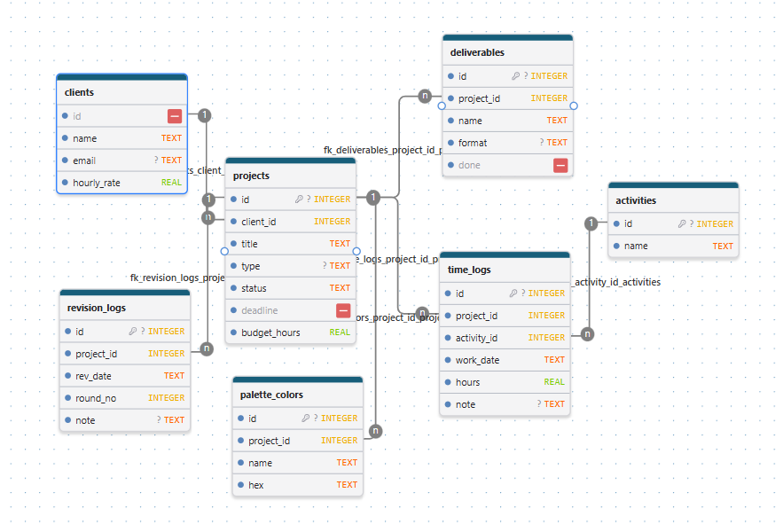

# Dizaina projektu pārvaldnieks

Vienkārša darbvirsmas lietotne dizaina darba ikdienas plānošanai. Tā palīdz pārvaldīt klientus un projektus, uzskaitīt nostrādāto laiku, saglabāt projekta krāsu paleti un sekot līdzi labojumu kārtām. Lietotnes saskarne un šī pamācība ir latviešu valodā.

## Kā izskatās datubāze



## Iespējas

- **Klienti:** saglabā klienta vārdu, e-pastu un stundas likmi.
- **Projekti:** piesaisti projektu klientam un norādi veidu, termiņu, plānotās stundas un statusu.
- **Laika uzskaite:** reģistrē darbību, projektam veltīto laiku un piezīmi.
- **Krāsu paletes:** saglabā projekta krāsas un apskati to vizuālu priekšskatījumu.
- **Labojumu kārtas:** pieraksti, cik labojumu kārtu projektam ir bijis.
- **Kopsavilkums:** apskati izmantotās un atlikušās plānotās stundas, kā arī aprēķināto ienākumu.

## Prasības

- Python 3
- Tkinter (parasti iekļauts Python instalācijā)
- SQLite (iekļauts Python standarta bibliotēkā)

Lietotne neizmanto papildu Python pakotnes.

## Palaide

1. Lejupielādē vai klonē šo repozitoriju.
2. Atver termināli repozitorija mapē.
3. Palaid grafisko lietotni:

   ```bash
   python main.py
   ```

   Dažās sistēmās komandas nosaukums ir `python3`:

   ```bash
   python3 main.py
   ```

Lietotne pirmās palaišanas laikā izveido vai atver `design_tracker.db` datubāzes failu. Grafiskās lietotnes vietā var palaist arī vienkāršu termināļa izvēlni ar `python terminal.py`.

## Kā lietot

1. Cilnē **Klienti** pievieno klientu.
2. Cilnē **Projekti** izvēlies klientu un izveido projektu.
3. Izvēloties projektu tabulā, vari mainīt tā statusu, pievienot labojumu kārtu vai apskatīt kopsavilkumu.
4. Cilnē **Laika uzskaite** reģistrē darbības un tām veltītās stundas.
5. Cilnē **Krāsu paletes** izvēlies projektu un pievieno krāsas ar HEX kodu, piemēram, `#4F46E5`.

## Projekta faili

| Fails | Kas tajā atrodas |
| --- | --- |
| `main.py` | Grafiskā lietotne, tās logi, tabulas un ievades pārbaudes. |
| `terminal.py` | Vienkāršāka lietotnes versija darbam terminālī. |
| `database.py` | SQLite tabulu izveide un datu saglabāšanas funkcijas. |
| `design_tracker.db` | SQLite datubāze ar lietotnes datiem. |
| `image.png` | Datubāzes shēmas attēls. |

## Koda iepazīšana

Ja mācies Python, vari sākt ar šiem soļiem:

1. Apskati `main.py` funkciju `build_window`, lai redzētu, kā tiek veidots lietotnes logs un cilnes.
2. Apskati `add_client` vai `add_project`, lai redzētu, kā ievadītie dati tiek pārbaudīti pirms saglabāšanas.
3. Atver `database.py` un atrodi atbilstošo `add_...` funkciju, kas saglabā datus SQLite datubāzē.
4. Funkcija `refresh_data` ielasa saglabātos datus un parāda tos lietotnes tabulās.

Kods izmanto Python standarta bibliotēkas `tkinter` un `sqlite3`, tāpēc var mācīties, neinstalējot papildu pakotnes.
