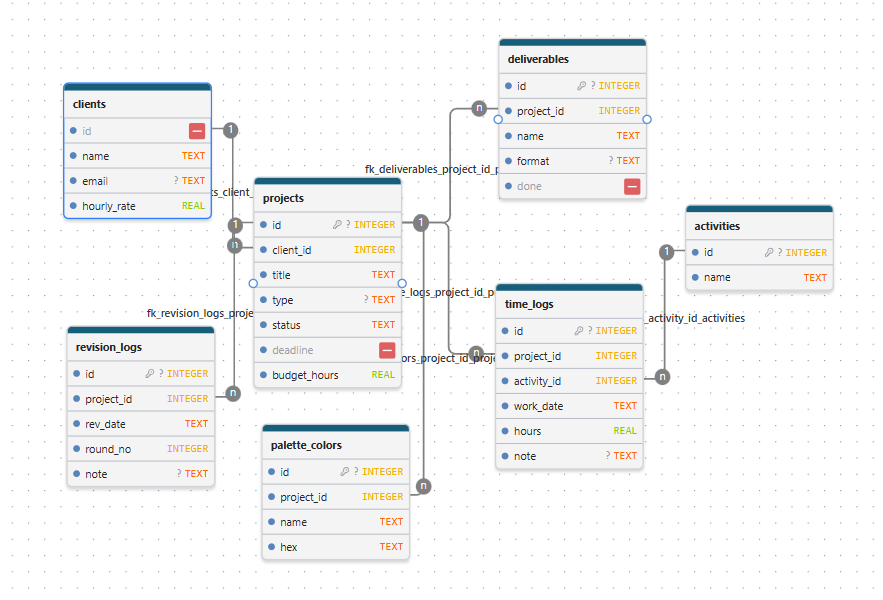

# Design Project Tracker (Dizaina projektu pārvaldnieks)

Konsoles un grafiskā lietojumprogramma Python valodā ar SQLite datubāzi, lai sekotu līdzi dizaina klientiem, projektiem, nostrādātajam laikam, krāsu paletēm un labojumu kārtām.

## Galvenās iespējas

- Klientu pārvaldība: klienti un individuālās stundas likmes (clients).
- Projekti: projektu katalogs ar veidu, statusu, termiņu un plānotajām stundām (projects, deliverables).
- Laika uzskaite: darbības (skices, maketēšana, ilustrēšana...) un nostrādātās stundas (time_logs, activities).
- Krāsu palete: katra projekta krāsas ar vizuālu priekšskatījumu (palette_colors).
- Labojumu kontrole: labojumu kārtu vēsture laika gaitā (revision_logs).
- Kopsavilkums: izmantotās un atlikušās stundas, nopelnītā summa.

## DB shema

## Tehnoloģijas

- Python 3.x
- SQLite3 (iebūvēts)
- Tkinter (iebūvēts)